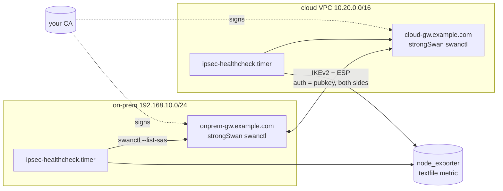

# IPsec site-to-site tunnels with strongSwan and Ansible

An Ansible playbook and role that set up an IKEv2 IPsec tunnel between an
on-premises gateway and a cloud gateway, both running strongSwan with
`swanctl`. Both sides authenticate with **X.509 certificates** (no
pre-shared key). Each gateway gets a small health check, run by a systemd
timer, that logs the tunnel state and writes a Prometheus textfile metric.

> **Status:** CI runs `yamllint`, `ansible-lint` (production profile),
> `ansible-playbook --syntax-check`, `shellcheck`, and 19 pytest tests. The
> tests run the health-check script against a fake `swanctl`, render the
> templates, and check key-file handling and that no key or certificate is
> in git. **No tunnel has been brought up**: CI has no gateways, so the
> role has never run against a real host, and the swanctl config has not
> been loaded by a real strongSwan.

## Problem

> Build an Ansible playbook that configures IPSec VPN tunnels between
> on-premises and cloud with certificate-based authentication and
> monitoring.

## Layout



The playbook treats the cloud end as a strongSwan VM (for example an EC2
instance) rather than a managed cloud VPN service, so both ends use the same
role. That was the simpler choice.

## What the role does

1. Checks that the tunnel settings and the vault key are present and that
   the OS family is supported; stops otherwise.
2. Installs strongSwan (`charon-systemd` + `strongswan-swanctl` on
   Debian/Ubuntu, `strongswan` on EL).
3. Turns on `net.ipv4.ip_forward` so the gateway routes subnet traffic.
4. Installs the CA certificate and the host certificate from paths on the
   controller (`0644`).
5. Writes the host private key from a **vault variable** to
   `/etc/swanctl/private/<name>.key`, owner `root`, mode **`0600`**, with
   `no_log: true`. The directory is `0700`.
6. Renders `/etc/swanctl/conf.d/<name>.conf` (`0640`) with `auth = pubkey`
   on both sides and the configured subnets, then runs
   `swanctl --load-all` through a handler.
7. Enables the `strongswan` service.
8. Installs the health check script, a oneshot service, and a timer.

## Secrets: certificates, keys and vault layout

Nothing secret is in this repo. `.gitignore` excludes `pki/`, `vault.yml`,
`*.key`, `*.pem`, `*.crt` and `*.p12`, and a test fails if any tracked file
contains a PEM key or certificate block.

Expected layout on the controller (everything marked _not committed_ stays
out of git):

```
pki/                                   # not committed
  ca.crt                               # public CA cert
  onprem-gw.example.com.crt            # host certs signed by the CA
  cloud-gw.example.com.crt
host_vars/
  onprem-gw.example.com.yml            # committed, non-secret
  onprem-gw.example.com/vault.yml      # not committed, ansible-vault encrypted
  cloud-gw.example.com.yml
  cloud-gw.example.com/vault.yml       # not committed, ansible-vault encrypted
```

Each `vault.yml`, before encryption, looks like this (placeholder only):

```yaml
---
vault_ipsec_tunnel_private_key_pem: |
  <PEM private key for this host, from your CA process>
```

Encrypt it with `ansible-vault encrypt host_vars/<host>/vault.yml`.
The certificate `CN` must match `ipsec_tunnel_local_id` / `remote_id`.

## Monitoring

`/usr/local/sbin/ipsec-healthcheck <name>` runs every minute from
`ipsec-healthcheck.timer`:

- runs `swanctl --list-sas --ike <name>`;
- the tunnel is **up** only if the IKE SA is `ESTABLISHED` **and** the
  child SA is `INSTALLED`;
- writes `ipsec_tunnel_up{tunnel="<name>"} 1|0` and a timestamp to
  `/var/lib/node_exporter/textfile_collector/ipsec_tunnel_<name>.prom`
  (written to a temp file and renamed, so it is never half-written);
- logs to the journal (`journalctl -u ipsec-healthcheck`);
- exits `0` up, `1` down, `2` if `swanctl` itself failed, `64` on bad
  usage. A non-zero exit marks the unit failed, so `systemctl --failed`
  shows a down tunnel too.

Alert on `ipsec_tunnel_up == 0` or on a stale timestamp. Installing
node_exporter is out of scope.

## Usage

```bash
# Run the same checks CI runs (Linux or WSL; ansible-core does not run on Windows)
python -m pip install -r requirements-test.txt
yamllint .
ansible-lint
ansible-playbook -i inventory/hosts.ini site.yml --syntax-check
shellcheck roles/ipsec_tunnel/files/ipsec-healthcheck.sh
python -m pytest -q tests

# Real run, once pki/ and the vault files exist
ansible-playbook -i inventory/hosts.ini site.yml --ask-vault-pass --check --diff
ansible-playbook -i inventory/hosts.ini site.yml --ask-vault-pass
```

Main variables (see `roles/ipsec_tunnel/defaults/main.yml`):

| Variable | Example |
|---|---|
| `ipsec_tunnel_name` | `onprem-cloud` |
| `ipsec_tunnel_local_addr` / `remote_addr` | `198.51.100.10` / `203.0.113.20` |
| `ipsec_tunnel_local_id` / `remote_id` | `CN=onprem-gw.example.com` |
| `ipsec_tunnel_local_subnets` / `remote_subnets` | `["192.168.10.0/24"]` |
| `ipsec_tunnel_private_key_pem` | from vault |
| `ipsec_tunnel_ca_cert_src` / `cert_src` | `{{ playbook_dir }}/pki/...` |

## Limits

- One tunnel per host (one `ipsec_tunnel_name`). More tunnels need a loop
  or more role runs.
- The swanctl option names used (`start_action`, `dpd_action`,
  `close_action`) are from strongSwan 5.9; check them against the version
  your distro ships.
- Package and service names differ between distro releases; `strongswan`
  as the service name is an assumption to verify per distro.
- Not managed here: firewall rules (UDP 500, UDP 4500, ESP), cloud route
  tables, disabling the EC2 source/destination check, certificate issuance
  and renewal, CRL/OCSP checks.
- IPv4 forwarding only; no IPv6 traffic selectors.

## Security notes

- Certificate auth on both sides; no PSK appears anywhere.
- Private key: vault-sourced, `0600`, root-owned, in a `0700` directory,
  never logged.
- `host_key_checking = True` in `ansible.cfg`; it is never turned off.
- IKE and ESP proposals default to AES-256-GCM with ECP-384.

## Idempotency

Every task is declarative (`package`, `copy`, `template`, `file`,
`systemd_service`), so a second run reports no changes. `swanctl
--load-all`, `sysctl --system` and the systemd reload run only as handlers,
when a file they depend on actually changed.
